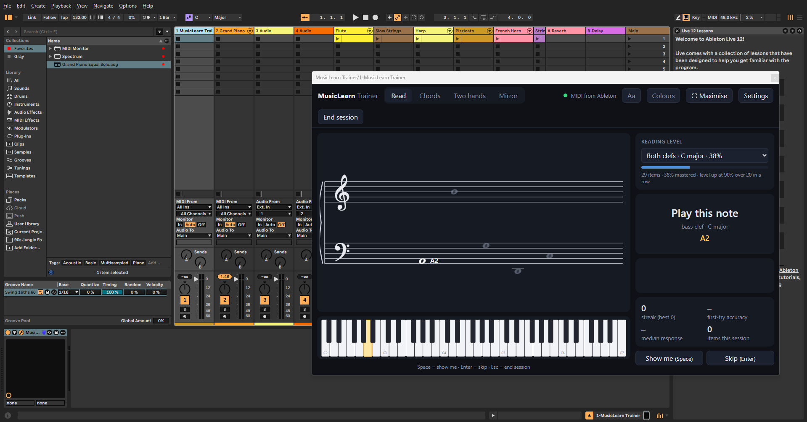

# MusicLearn Trainer

A VST3 plugin for Ableton Live (or any VST3 host on Windows) that turns your MIDI keyboard into a
music-reading, chord and play-along trainer. It sits on a MIDI track, watches what you play, shows
it on a real grand staff, and tells you — visually, never with sound — whether you played what was
asked. In Songs mode it follows Live's transport, so you can play a chord chart in time against a
drum loop or the original track. MIDI passes straight through, so recording, instruments, Spectrum
and everything else in Live keep working.



Built with [JUCE 8](https://juce.com) (WebView2 front end) and the
[Bravura](https://github.com/steinbergmedia/bravura) music font.

## Why

Most people who learn keyboard from "falling notes" videos never learn to read music or to
understand the chords they are playing, because the video always shows the answer. This plugin
hides the answer and makes you produce it, on the keyboard you already have, inside the DAW you
already use.

## Setting it up in Ableton Live

1. Install the plugin (see [Building](#building), or copy a release into
   `C:\Program Files\Common Files\VST3\`). In Live: **Options → Preferences → Plug-Ins**, make sure
   **Use VST3 System Folders** is on, then **Rescan**.
2. In the browser go to **Plug-Ins → VST3 → MusicLearn → MusicLearn Trainer** and drag it onto
   a new MIDI track. Name the track "Trainer".
3. On that track set **MIDI From** to your keyboard (or *All Ins*) and **Monitor** to **In**.
4. Click the wrench icon on the device to open the trainer window. Drag its corner to resize,
   or press **Maximise** in the header.
5. To hear yourself while you practise, use a second MIDI track with any instrument on it, with
   the same **MIDI From** and **Monitor In**. Both tracks receive the keyboard; the trainer sees
   every note, the instrument makes the sound, and you can arm and record the instrument track
   as usual.

   Alternative: set the instrument track's **MIDI From** to the *Trainer* track and choose
   *MusicLearn Trainer* in the second chooser — the plugin's MIDI output is the same notes.

Controllers with drum pads (Novation Launchkey, for example) usually send the pads on MIDI
channel 10; the trainer ignores that channel by default (Settings → *Ignore MIDI channel 10*).

### Playing along inside Live (Songs mode)

With **Follow Live's transport** ticked (the default inside Live), the song chart is locked to the
arrangement: **bar 1 of the arrangement is bar 1 of the song**, and Live's tempo is the song's
tempo. So:

1. Set Live's tempo to the song's bpm (shown in the Songs card), or slower while learning.
2. Press Play in Live; the trainer counts bars with it. Use Live's metronome, a drum loop, or the
   original recording on an audio track (warped to the tempo, lined up so its first bar is bar 1).
3. Drag Live's loop brace over the bars you want to drill; the trainer scores each pass.

Without the transport (the Standalone build, a browser, or with the box unticked) the trainer runs
its own clock: pick a section, a tempo in bpm (−5 / +5 or type it) and optionally *loop it*, press
**Play** (Space), and a one-bar count-in (two bars in 2/4) leads into the song. Changing the bpm while following
Live hands the clock to the plugin (a plugin cannot set Live's tempo); tick *Follow Live's
transport* again to give it back. The built-in metronome is a WebAudio click; inside Live prefer
Live's own metronome.

### Hearing the part: the guide

**Guide plays the part** makes the plugin play the arrangement itself, through its MIDI output on
channel 2, sample-accurately on the beat. For that to be audible, route your instrument track
from the plugin rather than from the keyboard: on the piano track set **MIDI From** to the
*Trainer* track and choose *MusicLearn Trainer* in the second chooser. Your own notes still pass
through the plugin, so the piano plays both you and the guide. The slider sets the guide's
volume; **fades as I play** ducks it against how hard you are playing (recent note velocities):
play with conviction and the guide drops out, hesitate or stop and it comes back within a couple
of seconds. In a browser the built-in synth stands in for the instrument.

Note names follow standard notation (middle C = **C4**). Live's piano roll calls the same key
**C3**; switch to Ableton naming in Settings if that is less confusing.

## Using it

Four tabs, each with levels that unlock as you master them:

- **Read** — a note is drawn on the staff; play it. Levels go treble → bass → both →
  accidentals → key signatures → ledger lines.
- **Chords** — a chord symbol (`Dm7`) or a roman numeral (`vi in G major`) is shown; play it in
  any inversion. Levels go triads → all roots → dim/aug → roman numerals → 7ths.
- **Two hands** — left hand plays the root below middle C, right hand plays the chord above it.
  Also measures how close together the two hands land (in milliseconds).
- **Songs** — play a whole song from a real page of piano music, in time. The song is engraved
  on a grand staff like a printed piano/vocal score: title, tempo mark, dynamic, brace, clefs, key
  and time signatures, bar lines with double bars at section changes, rehearsal marks, bar
  numbers, chord symbols, note values down to thirty-seconds with stems, flags, beams (double and
  triple for sixteenths and thirty-seconds), dots, ties and rests, accidentals (with courtesy
  accidentals), key changes, trills, rolled chords and fingering on the first occurrence of each
  shape. Four bars per
  line, two lines on screen, and the page follows the cursor so the line you are on and the next
  one are always visible; narrow windows drop to two or three bars per line (or pin it under
  *Bars per line*). A cursor moves through the bar; noteheads turn green, amber or red as each hit
  is scored, and a wrong note you are holding is drawn in red at its own pitch. Every hit is scored
  for pitch (any inversion, LH below the split point) and timing against the beat: on the beat
  (±50 ms), close (±120 ms), early/late, partial (a wrong or missing note) or missed.
  *Staff* switches between notes with chord symbols (the book default), notes only, and chord
  symbols over rhythm slashes (a chord chart, so you must know the voicings). Space = play/stop,
  Enter = restart from the top. The songs:
  - *Always Remember Us This Way* is a chord chart, not a transcription: the accompaniment is
    yours to play, the melody is not shown. Four arrangements: **Easy** (whole-note chords,
    slower), **Medium** (RH quarter-note chords, LH half-note roots), **Hard** (LH
    root–5th–octave–5th, RH dotted-quarter/eighth chords with voice-led inversions, sevenths and
    slash chords as charted) and **As recorded** (the record's piano part: RH continuous
    eighth-note broken chords, LH whole-note roots).
  - Mozart's *Rondo alla Turca* (the Turkish March, K. 331) is public domain, so it is written out
    note for note, and a hit wants exactly the written notes (either hand, any octave). Three
    arrangements: **Easy** (the A-minor theme, bars 1–25: the tune alone in the RH, one bass note
    per bar in the LH, 55% tempo), **Medium** (the theme and the A-major march, bars 1–33: RH as
    written, LH one note or chord per beat, 70%) and **Hard** (the whole movement as written,
    repeats skipped, rolled LH chords in the march, full tempo). Easy and Medium leave the
    ornaments out; right-hand grace notes are left out everywhere. Bar 1 is the pickup, so
    Trainer bar *n* is bar *n* − 1 in a printed score.
- **Mirror** — no test. Whatever you hold is drawn on the staff and named (chord, inversion,
  interval). Use it to explore.

Buttons/keys: **Space** shows the answer (counts as a hint), **Enter** skips, **Esc** ends the
session and shows a summary you can copy into a practice log.

Header toggles: **Aa** writes the note name next to every note on the staff; **Colours** gives
each letter its own colour (C red, D orange, E yellow, F green, G blue, A purple, B pink — sharps
and flats share their letter's colour) on the staff and on the piano. Both are training wheels:
turn them off once the positions are familiar. **Maximise** asks Windows to maximise the plugin
window (Live only offers a close button); it falls back to filling the screen if the host ignores
it.

Settings also has **Delay before the next item** (default 250 ms; 0 = instant) and **Preview
upcoming items** (default 4): in Read mode the coming notes are drawn further along the staff
like a line of music, in Chords / Two hands they appear as a "Next:" line.

## How it is designed to teach

- **Retrieval, not copying.** Falling-note videos show the answer; the trainer hides it and makes
  you produce it. New items are shown once with the answer (guided), then never again unless you
  ask or fail.
- **Immediate, specific feedback.** A wrong note is drawn in red on the staff exactly where it
  sits, next to the note that was asked, with a message such as "F5 — one step too high" or
  "the key signature makes every F sharp".
- **Misses come back within a few items** (short-loop re-testing), and the item selector
  weights everything by your error rate and how long since you last saw it — a light form of
  spaced repetition.
- **Interleaving.** Items are mixed within a level rather than drilled in blocks.
- **Mastery gates.** A level suggests moving on when the last 16–20 scored items are ≥90 %
  first-try with a quick median response. Nothing is forced; pick any level any time.
- **Two-hand coordination** is trained with the simplest possible left-hand job (one note) and a
  measurable target (hands landing within ~30 ms).
- **Songs are the goal, drills are the means.** Songs mode is reading practice with a pulse: a
  page that looks like the book, a cursor that does not wait, and the answer (highlighted keys,
  chord symbols) removable one setting at a time. Timing is scored per hit and summarised per run
  (accuracy, mean timing error, whether you rush or drag, the chords you missed most), and the
  best run per arrangement is kept.
- **No sound cues.** Success is a soft green flash and a tick; errors a red flash. The
  instrument you route to is the only thing you hear.

Progress is stored in the plugin's WebView2 profile (`%LOCALAPPDATA%\MusicLearnTrainer\WebView2`),
so it persists across Live sessions and sets. Nothing leaves your machine.

## Building

Windows only for now (the UI is hosted in WebView2).

Requirements:

- Visual Studio 2022 or later with the **Desktop development with C++** workload.
- Python 3 with `pip install cmake ninja` (the build script picks CMake and Ninja up from the
  Python packages, so no separate installs are needed).
- A JUCE 8.0.8 checkout: `git clone --depth 1 --branch 8.0.8 https://github.com/juce-framework/JUCE.git`
- The [Microsoft.Web.WebView2](https://www.nuget.org/packages/Microsoft.Web.WebView2/1.0.4314.35)
  NuGet package (1.0.4314.35), extracted so that the `Microsoft.Web.WebView2.1.0.4314.35`
  folder sits inside a directory of your choosing. `CMakeLists.txt` pins that version
  (`WEBVIEW2_SDK_VERSION`) and stops with the download link if the folder isn't there.

By default `CMakeLists.txt` looks for JUCE at `%USERPROFILE%\Documents\git\JUCE` and the WebView2
package under `%USERPROFILE%\Documents\git\_deps\webview2`. Either put them there or pass
`-DJUCE_DIR=... -DJUCE_WEBVIEW2_PACKAGE_LOCATION=...` to CMake.

```
build.cmd          # configures with CMake + Ninja, builds VST3 and Standalone
install.cmd        # copies the VST3 into C:\Program Files\Common Files\VST3\ (asks for admin)
update.cmd         # build.cmd then install.cmd (one UAC prompt)
live-ui on|off     # load ui/ from this folder instead of the built-in copy (see below)
python package.py  # zips the built VST3 + INSTALL.txt into dist/ for a GitHub release
```

Build output goes to `%LOCALAPPDATA%\MusicLearnTrainer\build\MusicLearnTrainer_artefacts\Release\`
so the source tree stays clean. After installing, reload the plugin in Live (or
**Preferences → Plug-Ins → Rescan**). If Live has the old build loaded, `install.cmd` moves the
locked DLL aside and Live picks up the new one the next time the plugin is loaded.

The Standalone build is handy for testing without a host. Close Live before running it: Windows
lets only one program hold a MIDI port.

### Working on the UI

The whole UI is a single file, `ui/index.html`, embedded into the plugin at build time. To work on
it without rebuilding, serve the `ui` folder and open it in Chrome:

```
cd ui
python -m http.server 8765
# then open http://127.0.0.1:8765/index.html
```

In a browser the page uses Web MIDI (close Live first) or the computer keyboard (A–K = C4–C5,
W E T Y U = black keys, Z/X = octave), and has a built-in practice sound.

To work on it inside Live, run `live-ui on` once. The plugin then serves `ui/` straight from this
folder instead of the copy built into it (the footer says *Live UI*) and reloads the page about a
second after `index.html` is saved, so edits, new songs included, appear in Live with no build,
install or re-added device. Progress is kept: it is the same page origin and WebView2 profile.
It takes effect the next time the plugin window opens, and it is a per-machine setting
(`%LOCALAPPDATA%\MusicLearnTrainer\ui-dir.txt`), so release builds always use their built-in UI.
`live-ui off` switches back; run `update.cmd` before a release so the built-in copy is current.
Changes to `Source/` still need `update.cmd` and a re-added device.

Levels and item pools are plain data (`LEVELS`, `itemsFor`) in the HTML; add new drills there.

Songs are data too (`SONGS`, just above `boot()`): a chord chart as sections of bars (`'F:1 G:1 Am:2'`
= three chords in one bar with explicit beat counts, `'F G'` = two chords sharing the bar, `%` =
repeat the previous bar, `like:` replays a named section) plus `versions`, each naming a rhythmic
pattern (`block`, `pulse`, `ballad`, `eighths` in `SONG_PATTERNS`: per hand, offset / duration /
what to play), a `simplify` level (0 = as charted, 1 = triads and sus with the charted bass, 2 =
plain triads), a voicing (`root` or `lead`), a default tempo percentage and the default staff view.
`compileSong` turns that into per-hand note events and scoring hits; `layoutSong` splits the
events into notatable values (ties across the half-bar, rests in the gaps, beams by half-bar,
stems by the note farthest from the middle line, accidentals per bar) and spaces the bars
proportionally; `renderPage` draws two systems with Bravura's SMuFL glyphs. Nothing else needs to
change to add a song.

A public-domain piece can be written out instead: next to its chart (`bars`), each section gets
`rh` and `lh`, one string of notes per bar (`'8C5 r 16D5 C5 B4 C5'`: a duration — 4 = quarter, 8,
16, 32, a trailing `.` dots it — carries on until changed; notes are joined with `+` into chords,
`~` ties a note into the next chord, `{G5+A5}` in front are grace notes, a trailing `tr` is a trill).
`key:` on a section changes the key signature from there, and `pickup:` says how many beats at the
end of the section lead into the next one. Its versions name `parts` instead of a pattern (RH
`score` or `melody`; LH `score`, `beat` or `bar`), optionally stop `through:` a section, and set
`ornaments:false` or `rolled:true`; the comment above `parseWrittenNote` has the details. A bar
that doesn't add up to the time signature is an error on load, which catches most typing slips.

## Layout

```
CMakeLists.txt        JUCE plugin definition (VST3 + Standalone)
build.cmd             one-shot MSVC + CMake + Ninja build
install.cmd/.ps1      elevated copy into the system VST3 folder
package.py            release zip (dist/) from the build output
Source/               thin C++ shell: MIDI FIFO, host transport snapshot + WebView2 host
ui/index.html         all UI and learning logic
ui/Bravura.woff2      music notation font (SIL OFL)
```

## Roadmap

- More songs; a rhythm level that reads notated rhythms rather than chord symbols.
- Engrave grace notes (the Turkish March leaves its right-hand ones out).
- Ear training: identify intervals/chords played by the host.
- Progress chart across sessions.
- macOS build (WebKit back end).

## Licence

MusicLearn Trainer is released under the [GNU AGPL v3](LICENSE), which is what the AGPLv3 option
of the JUCE licence requires. The Bravura font is © Steinberg Media Technologies GmbH and
licensed under the SIL Open Font License 1.1 (`ui/LICENSE-Bravura.txt`).
